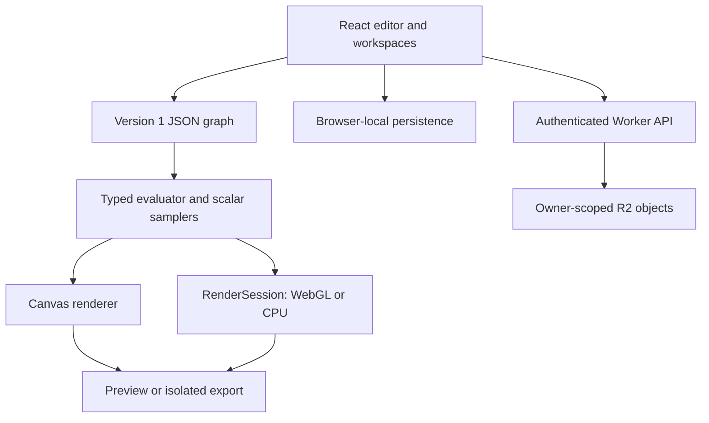

# Architecture and source map

## Runtime structure

The frontend owns editing, geometry evaluation and rendering. The Worker serves built assets and handles authenticated storage. There is no server-side graphics engine, AI inference API, proprietary binary renderer or external render farm required for local editing.

Rendered image values are recipes/layers rather than already-rendered image buffers. Graph evaluation can therefore remain mostly browser-independent and serializable; the renderer interprets those recipes at a specific time and resolution.

## File responsibilities

| Location | Responsibility | Change here when… |
| --- | --- | --- |
| `src/main.jsx`, `index.html` | React entry and document shell | Changing app startup/metadata |
| `src/App.jsx` | Document state, selection, history, dialogs, source import, preview loop and top-level orchestration | Changing editing behaviour or command routing |
| `src/model.js` | Registry composition, types, constructors, connection validation, migration, evaluation/cache, native/output transforms and history | Adding a type/node or changing graph semantics |
| `src/primitives.js` | Unified Shapes schema, visibility and procedural point generation | Changing primitive construction or mode-specific controls |
| `src/extended.js` | Additional node schemas, path sanitization and Bézier sampling | Changing glass/effect/Fluid/source definitions or vector bounds |
| `src/signals.js` | Seeded scalar expressions, field sampling, context and compiled sampler cache | Adding a scalar generator/domain or field-weight behaviour |
| `src/field-distance.js` | Geometry distance/normal queries | Changing custom Shape Field evaluation |
| `src/groups.js`, `src/GroupDialog.jsx` | Packing/scoping groups, exposed controls and reusable instances | Changing nested graphs or group interfaces |
| `src/GraphView.jsx` | React Flow diagram, node handles/ports, selection, edges | Changing graph interaction/visualization |
| `src/ui.jsx` | Inspector, parameter widgets, drive links and common UI | Changing parameter editing or schema-driven control display |
| `src/Dropdown.jsx`, `src/ShapeSelector.jsx` | Shared accessible custom menus and primitive icons | Changing dropdown semantics or menu appearance |
| `src/CanvasOverlay.jsx` | Canvas selection, transforms, path anchors/handles and field guides | Changing direct manipulation |
| `src/Workspace.jsx`, `src/workspaces.js`, `src/workspace.css` | Docking, floating panels, responsive layout and named-layout validation | Changing panel layout persistence |
| `src/clock.js`, `src/Timeline.jsx` | Time/playback and timeline UI | Changing playback or seeking |
| `src/render.js` | Canvas paths, glow, scalar material textures, bitmap decoding and render dispatch | Changing base vector appearance or image composition |
| `src/gpu-renderer.js` | Geometry rasterization, signed-distance source, driver atlas, fixed-step sessions, caching and CPU recovery | Changing the graph-to-renderer bridge |
| `src/render-budget.js` | Shared preview caps and geometry-context detection | Changing interactive performance budgets |
| `src/gpu/engine.js`, `src/gpu/shaders.js` | WebGL resources, rendering passes and simulation shaders | Changing GPU optics or solver |
| Other `src/gpu/*.js` | Geometry, defaults, effects, driver-uniform plumbing and supporting math | Extending a particular rendering feature |
| `src/cpu-renderer.js` | CPU simulation/material fallback | Fixing unsupported-GPU behaviour or fallback parity |
| `src/animation.js` | Frozen graph export engine, warm-up and private resource lifecycle | Changing offline export orchestration |
| `src/encoding/exports.js`, `mp4.js` | PNG ZIP, recorder/encoder negotiation and MP4 container | Changing output format, framing, memory limits or codecs |
| `src/AnimationExport.jsx` | Export controls/progress/cancellation | Changing export UI |
| `src/graphics.js` | Graphic import, SVG sanitization, editable path conversion and edits | Changing import support or path editing |
| `src/cloud.js` | Cloud hook, autosave state machine, revision handling and snapshot list | Changing sync/recovery behaviour |
| `server/documents.js` | API routes, authenticated owner prefix, payload cleaning and conditional object writes | Changing cloud data/API/security |
| `server/worker.js` | Fetch routing, embedded asset serving and safe error responses | Changing server dispatch/static delivery |
| `vite.config.js` | Local `/api/` fallback and Vite setup | Changing local development |
| `scripts/build-worker.mjs` | Build client, embed assets, bundle a Worker ES module | Changing deployment output |
| `tests/*.test.mjs` | Node test runner coverage for core contracts | Verifying model/storage/solver regressions |

## State and resource boundaries

Persisted document state uses React-compatible immutable updates. Node editor positions are diagram layout; node `params.x/y` are artwork coordinates. Moving a node in the diagram must not move the artwork or invalidate geometry unnecessarily.

`createEvaluator()` holds reusable dependency caches outside the graph. `signalFunction()` compiles JSON expressions into closures held in a WeakMap. A frame-local evaluation avoids repeated work within one traversal. Context-dependent upstream geometry is reevaluated for individual Copy instances; uniform branches can reuse results. Do not mutate cached arrays or expressions in place and expect the identity-based cache to notice.

`RenderSession` owns WebGL/CPU resources and simulation time. The preview has a long-lived session; export gets a new session and structured clone of the root document. Geometry source fields, driver textures and fluid state are not project assets and are regenerated. Dispose sessions on teardown/cancel; prune inactive render layers to avoid leaking contexts/buffers.

The animation clock and canvas paint loop are kept separate from the React document/diagram. Renderer changes should preserve that boundary: a frame should not rebuild the entire React Flow tree. The performance panel is available through the `perf` query flag; see the quality guide for interpreting it.

## Build dependencies

Direct runtime dependencies are React, React DOM, React Flow (`@xyflow/react`) and Lucide React. Vite is the direct development dependency. The lockfile is the reproducibility source; version ranges in `package.json` are not a substitute. [The generated dependency inventory](../reference/dependencies.json) lists the locked dependency graph and licence declarations.

`scripts/extend-model.py` is a historical string-patching utility. It is not part of startup/build and should not be reapplied to the current implementation. The authoritative implementation is already in `src/`.
